# UI & Operations Console Gallery

This gallery showcases high-resolution screenshots of all modules, pages, and interactive workflows in the **MikroTik ISP Billing & RouterOS Operations Platform** in both **Dark Theme (Default)** and **Light Theme**.

---

## Table of Contents
1. [Operations Command Center (Dashboard)](#1-operations-command-center-dashboard)
2. [MikroTik Router Gateways Fleet](#2-mikrotik-router-gateways-fleet)
3. [Guided Zero-Downtime PPPoE Setup Wizard](#3-guided-zero-downtime-pppoe-setup-wizard)
4. [Subscriber Management & 360° Profile](#4-subscriber-management--360-profile)
5. [Live PPPoE Active Sessions Telemetry](#5-live-pppoe-active-sessions-telemetry)
6. [Bandwidth Tariff Packages & Pool Allocation](#6-bandwidth-tariff-packages--pool-allocation)
7. [Invoices, Billing Cycles & Recurring Runs](#7-invoices-billing-cycles--recurring-runs)
8. [Subscriber Service Lifecycle & Grace Policies](#8-subscriber-service-lifecycle--grace-policies)
9. [Financial Collections & Audit Trail Logs](#9-financial-collections--audit-trail-logs)
10. [SMS Alerts, Staff Roles & Tenant Settings](#10-sms-alerts-staff-roles--tenant-settings)
11. [Interactive Operations Modals & Dialogs](#11-interactive-operations-modals--dialogs)
12. [Landing, Login & Tenant Onboarding](#12-landing-login--tenant-onboarding)

---

### 1. Operations Command Center (Dashboard)
Real-time fleet health, 24-hour granular live aggregated PPPoE network throughput telemetry, monthly ledger collection rates, active tariff distribution, and quick cashier actions.

| Dark Theme (Default) | Light Theme |
|:---:|:---:|
|  |  |

---

### 2. MikroTik Router Gateways Fleet
Centralized management of physical CCR appliances, virtual CHRs, and RB-series devices with live CPU/RAM telemetry, connection diagnostic testing, socket health sync, and ROS version tracking.

| Dark Theme | Light Theme |
|:---:|:---:|
|  |  |

---

### 3. Guided Zero-Downtime PPPoE Setup Wizard
Step-by-step interactive configuration wizard for RouterOS devices. Automatically provisions IP pools, PPPoE server services, authentication profiles, and firewall rules with pre-execution dry-run diff safety inspection.

| Dark Theme | Light Theme |
|:---:|:---:|
|  |  |

---

### 4. Subscriber Management & 360° Profile
Customer directory with advanced filtering, real-time service statuses, assigned bandwidth plans, live interface telemetry, billing ledger balances, and payment transaction logs.

| Section | Dark Theme | Light Theme |
|---|:---:|:---:|
| **Subscribers Directory** |  |  |
| **Subscriber 360° Profile** |  |  |

---

### 5. Live PPPoE Active Sessions Telemetry
Real-time subscriber tunnel monitoring polled via MikroTik API `/interface/monitor-traffic`, session duration brackets, core gateway load distribution, and one-click remote session disconnection.

| Dark Theme | Light Theme |
|:---:|:---:|
|  |  |

---

### 6. Bandwidth Tariff Packages & Pool Allocation
Broadband rate card management with symmetrical/asymmetrical speeds, burst limits, priority levels, RouterOS PPP profile associations, and pool capacity tracking.

| Dark Theme | Light Theme |
|:---:|:---:|
|  |  |

---

### 7. Invoices, Billing Cycles & Recurring Runs
Automated recurring invoice generation, prorated billing runs, overdue aging calculations, payment recordings, and printable thermal cashier receipts.

| Section | Dark Theme | Light Theme |
|---|:---:|:---:|
| **Invoices & Ledger** |  |  |
| **Daily Billing Runs** |  |  |

---

### 8. Subscriber Service Lifecycle & Grace Policies
Automated suspension rules for overdue balances, customizable grace periods, non-destructive speed throttling profiles, and manual administrative overrides.

| Dark Theme | Light Theme |
|:---:|:---:|
|  |  |

---

### 9. Financial Collections & Audit Trail Logs
Visual revenue channel breakdowns (bKash, Nagad, Bank, Cash), daily collection volume trends, monthly collection rates, and immutable tenant-scoped audit trails.

| Section | Dark Theme | Light Theme |
|---|:---:|:---:|
| **Collections Report** |  |  |
| **Tenant Audit Trail** |  |  |

---

### 10. SMS Alerts, Staff Roles & Tenant Settings
Multi-channel SMS template editor, cashier invite workflows, role-based access permissions, and ISP tenant branding settings.

| Section | Dark Theme | Light Theme |
|---|:---:|:---:|
| **SMS & Alerts** |  |  |
| **Staff & Roles** |  |  |
| **Tenant Settings** |  |  |

---

### 11. Interactive Operations Modals & Dialogs

| Modal Workflow | Dark Theme | Light Theme |
|---|:---:|:---:|
| **Record Payment** |  |  |
| **Print Thermal Receipt** |  |  |
| **Register Router Gateway** |  |  |
| **Live Router Diagnostics** |  |  |
| **Add New Subscriber** |  |  |
| **Create Tariff Package** | 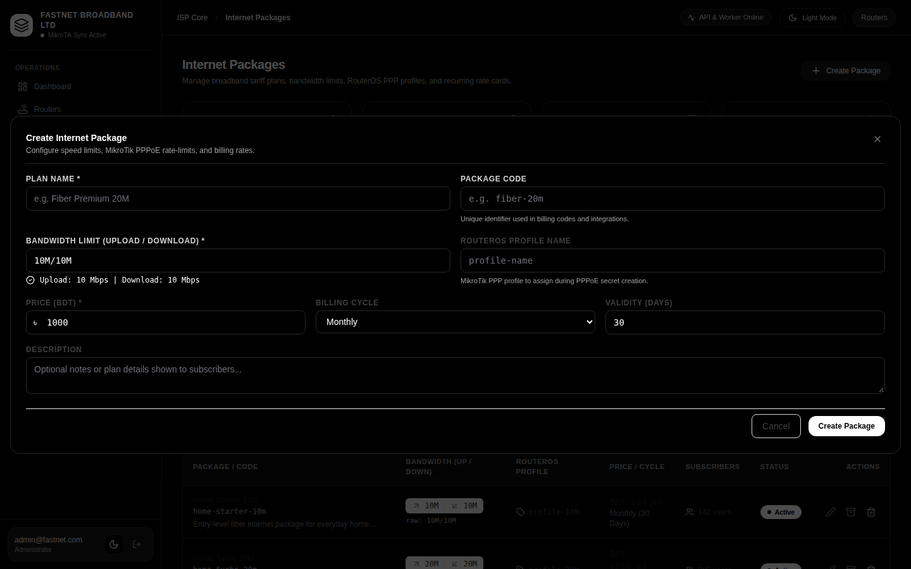 | 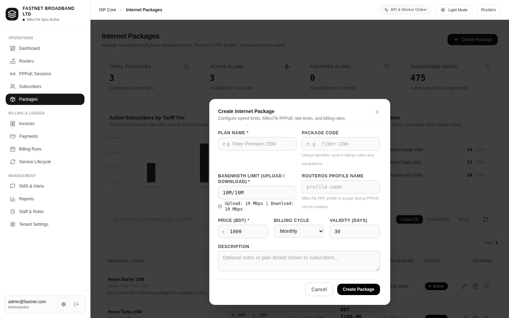 |
| **Disconnect PPPoE Tunnel** |  |  |
| **Modify Service Status** | 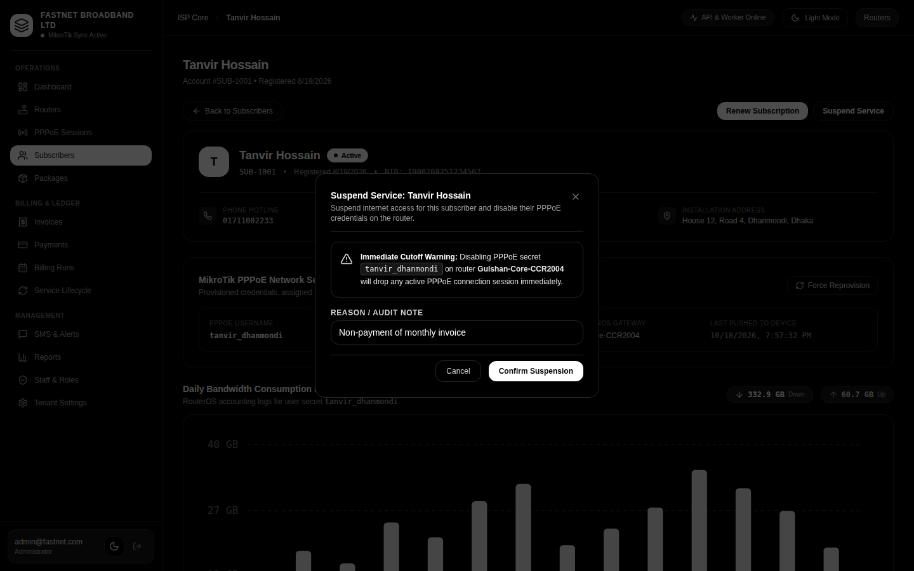 | 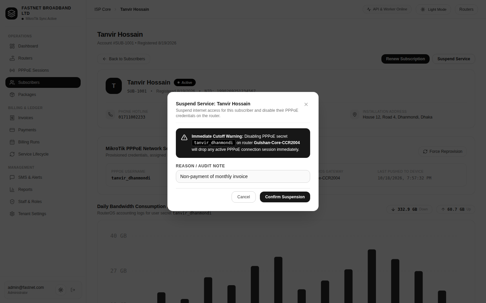 |
| **Invite Staff Member** | 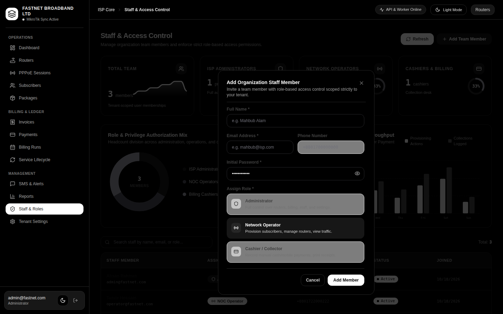 | 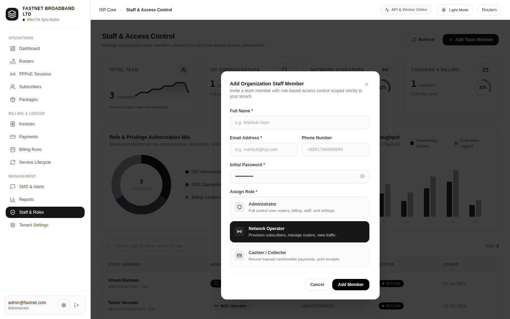 |

---

### 12. Landing, Login & Tenant Onboarding

| Page | Dark Theme | Light Theme |
|---|:---:|:---:|
| **Marketing Landing** | 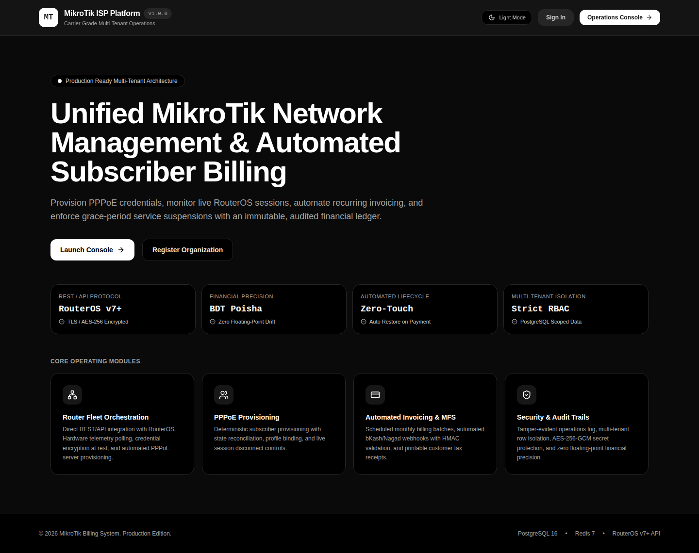 | 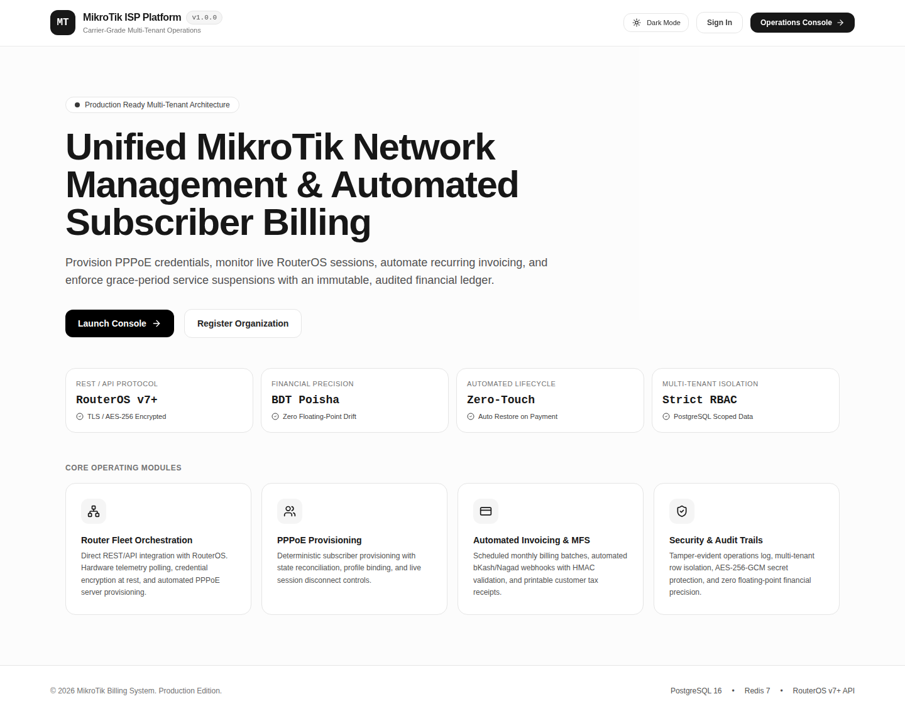 |
| **Operator Login** | 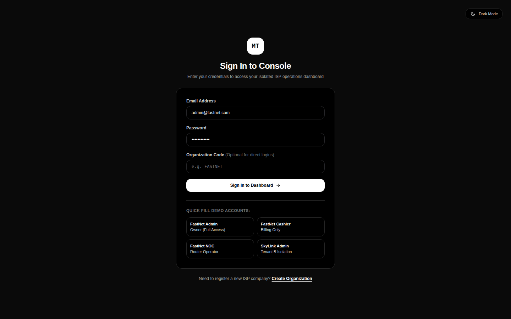 | 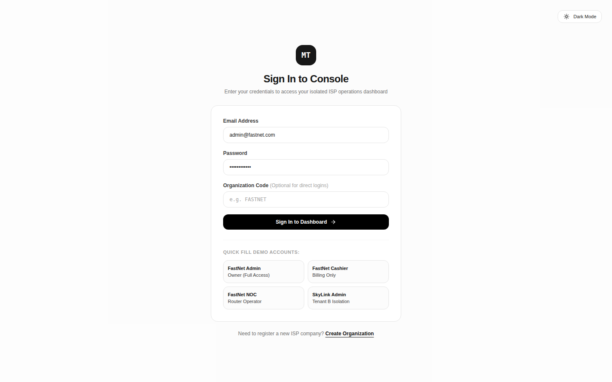 |
| **ISP Tenant Onboarding** | 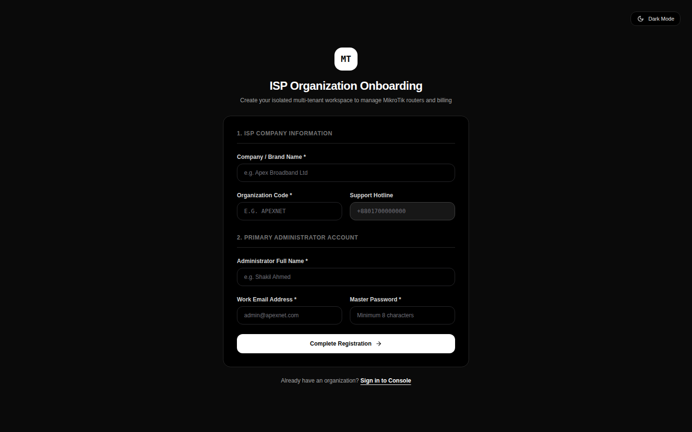 | 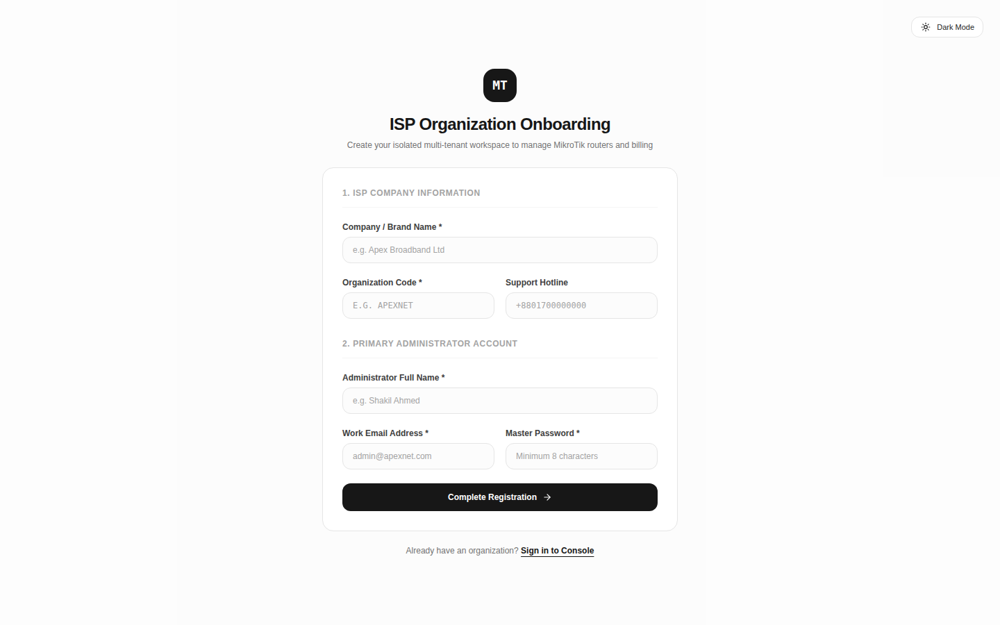 |

---

