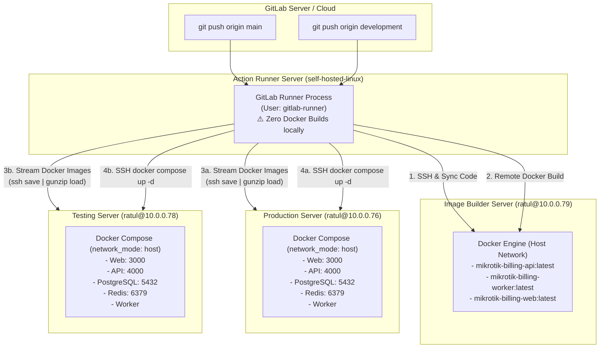

# GitLab CI/CD Pipeline Architecture & Operations Guide

This document details the automated continuous integration and continuous deployment (CI/CD) architecture for the **MikroTik ISP Billing & RouterOS Operations Platform**.

---

## 1. Pipeline Topology & Node Inventory

The CI/CD workflow is orchestrated across four specialized nodes within your private infrastructure:



### Server Matrix

| Role | Hostname / IP | User | Responsibilities | Trigger Branch |
|---|---|---|---|---|
| **GitLab Runner** | *Self-Hosted Runner* | `gitlab-runner` | Receives pipeline jobs, holds SSH keys, orchestrates builds & deploys via SSH. **Does NOT build Docker images.** | All |
| **Image Builder** | `10.0.0.79` | `ratul` | Builds Docker images in host network mode (`--network=host`), tags images. | `main`, `development` |
| **Production Host** | `10.0.0.76` | `ratul` | Receives production container images, updates `.env`, launches Compose stack in host network mode. | `main` |
| **Testing Host** | `10.0.0.78` | `ratul` | Receives test container images, updates `.env`, launches Compose stack in host network mode. | `development` |

---

## 2. Security & SSH Key Configuration

The GitLab runner executes jobs as the `gitlab-runner` system user. It uses pre-authorized SSH keys to execute non-interactive commands across all three nodes.

### Verification from the Runner Server

To verify that the `gitlab-runner` user can access all servers passwordlessly:

```bash
# Switch to gitlab-runner user
sudo su - gitlab-runner

# Test SSH connection to Image Builder (10.0.0.79)
ssh -o StrictHostKeyChecking=no ratul@10.0.0.79 "echo 'Connected to 10.0.0.79 as \$(whoami)'"

# Test SSH connection to Production Server (10.0.0.76)
ssh -o StrictHostKeyChecking=no ratul@10.0.0.76 "echo 'Connected to 10.0.0.76 as \$(whoami)'"

# Test SSH connection to Testing Server (10.0.0.78)
ssh -o StrictHostKeyChecking=no ratul@10.0.0.78 "echo 'Connected to 10.0.0.78 as \$(whoami)'"
```

---

## 3. Pipeline Stages & Execution Flow

### Stage 1: Remote Image Build (`build`)

- **Jobs**: `build:production` (runs on `main`), `build:testing` (runs on `development`)
- **Execution Location**: Executed remotely on `ratul@10.0.0.79` via SSH.
- **Workflow**:
  1. Synchronizes the repository source code to `/home/ratul/docker/mikrotik-billing-system/` on `10.0.0.79` (using `rsync` if available, or direct streaming `tar` over SSH).
  2. Executes Docker builds with `--network=host` to avoid DNS lookup issues during dependency installation:
     ```bash
     docker build --network=host --target api -t mikrotik-billing-api:latest .
     docker build --network=host --target worker -t mikrotik-billing-worker:latest .
     docker build --network=host --target web -t mikrotik-billing-web:latest .
     ```
  3. Prunes intermediate build cache layers (`docker image prune -f`) to conserve builder storage.

### Stage 2: Direct Image Streaming & Deployment (`deploy`)

- **Jobs**: 
  - `deploy:production` (runs on `main` -> targets `ratul@10.0.0.76`)
  - `deploy:testing` (runs on `development` -> targets `ratul@10.0.0.78`)
- **Execution Location**: Orchestrated by runner, executing commands on the target host.
- **Workflow**:
  1. Synchronizes configuration and Compose files to the target server, strictly excluding any `.env` file to prevent overwriting production credentials.
  2. **Direct Image Streaming**: The runner streams the built images directly from the Image Builder (`10.0.0.79`) to the Target Server (`10.0.0.76` or `10.0.0.78`) via an in-memory SSH pipe:
     ```bash
     ssh ratul@10.0.0.79 "docker save mikrotik-billing-api:latest mikrotik-billing-worker:latest mikrotik-billing-web:latest | gzip -1" | \
       ssh ratul@<target-ip> "gunzip | docker load"
     ```
     > **Why this design is superior**:
     > - **Zero Runner Overhead**: No Docker daemon required on the runner server.
     > - **No External Registry Needed**: Eliminates reliance on Docker Hub, GitLab Container Registry, or external storage quotas.
     > - **Maximum Speed**: Transfers over fast internal network (`10.0.0.x`) with fast `gzip -1` compression.
  3. Ensures `.env` exists (copies `.env.example` if a fresh deployment).
  4. Launches the full platform in detached mode:
     ```bash
     docker compose up -d
     ```
  5. Automatically executes a health check probe loop against `http://127.0.0.1:4000/api/v1/health` until the NestJS API is operational.

---

## 4. Branching Strategy & Triggers

| Git Action | Target Branch | Pipeline Behavior | Target Environment |
|---|---|---|---|
| `git push origin development` | `development` | Runs `build:testing` on `10.0.0.79` & `deploy:testing` to `10.0.0.78` | **Testing Environment** (`http://10.0.0.78:3000`) |
| `git push origin main` | `main` | Runs `build:production` on `10.0.0.79` & `deploy:production` to `10.0.0.76` | **Production Environment** (`http://10.0.0.76:3000`) |
| Other feature branches | `feature/*` | Pipeline is not triggered (keeps builder and runner idle) | None |

---

## 5. Troubleshooting & Diagnostics

### Diagnostic Commands

#### 1. Checking Container Logs on Target Server:
```bash
# SSH into production or testing
ssh ratul@10.0.0.76 # or 10.0.0.78
cd /home/ratul/docker/mikrotik-billing-system

# View live logs
docker compose logs -f api
docker compose logs -f worker
docker compose logs -f web

# Check container status
docker compose ps
```

#### 2. Testing API Health Endpoint Manually:
```bash
curl -I http://127.0.0.1:4000/api/v1/health
# Expected output: HTTP/1.1 200 OK
```

#### 3. Inspecting Built Images on Image Builder:
```bash
ssh ratul@10.0.0.79 "docker images | grep mikrotik-billing"
```
