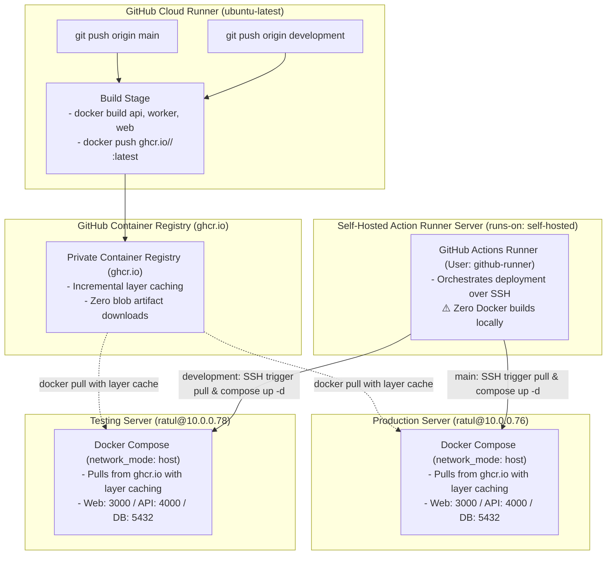

# GitHub Actions CI/CD Pipeline Architecture & Operations Guide

This document details the automated continuous integration and continuous deployment (CI/CD) architecture for the **MikroTik ISP Billing & RouterOS Operations Platform** running on **GitHub Actions** backed by **GitHub Container Registry (`ghcr.io`)**.

---

## 1. Pipeline Topology & Node Inventory

The workflow leverages GitHub Cloud for builds and GitHub Container Registry (`ghcr.io`) for instant, layer-cached container distribution:



### Server & Job Matrix

| Role | Environment | Runner / Host | Responsibilities | Trigger |
|---|---|---|---|---|
| **Build Job** | GitHub Hosted | `ubuntu-latest` | Builds Docker images and publishes to GitHub Container Registry (`ghcr.io`). | All pushes to `main` & `development` |
| **Self-Hosted Runner** | Local Subnet | `github-runner` (`self-hosted`) | Connects via SSH to target servers to orchestrate pulls and restarts. **Builds zero images.** | After build completion |
| **Production Server** | Production | `ratul@10.0.0.76` | Pulls images from `ghcr.io`, updates `.env`, launches Compose stack in host mode. | `main` branch |
| **Testing Server** | Staging / QA | `ratul@10.0.0.78` | Pulls images from `ghcr.io`, updates `.env`, launches Compose stack in host mode. | `development` branch |

---

## 2. Why GHCR Eliminates Artifact Download Freezes

In GitHub Actions, workflow artifacts (`actions/upload-artifact` and `actions/download-artifact`) upload raw zip files to **Azure Blob Storage**. When downloading a 340+ MB artifact onto a self-hosted runner:
1. `download-artifact@v4` uses a single Node.js HTTP stream without connection timeouts.
2. Cross-border networks or ISP firewalls frequently stall or drop these large streaming connections, causing the job to hang indefinitely (e.g. 26+ minutes).
3. Artifacts must be downloaded completely from scratch on every run.

**With GitHub Container Registry (`ghcr.io`)**:
- Docker pulls directly from GitHub's CDN using native Go multi-threaded chunking with automatic exponential backoff retries.
- **Layer Caching**: Only the changed application files (2–5 MB) are downloaded on each deploy—the base Alpine OS, Node.js runtime, and Prisma engines are cached permanently on the server.
- Deploys take seconds instead of minutes.

---

## 3. Zero Source Code Footprint on Target Servers

A key architectural advantage of containerized cloud builds is that **production and testing servers never receive raw source code**:

```text
Target Server Directory (/home/ratul/docker/mikrotik-billing-system/):
├── docker-compose.yml       # Orchestrates container lifecycles & port bindings
├── .env                     # Server secrets (encryption keys, DB passwords)
└── .env.example             # Initial template if .env does not exist yet
```

### Why No Source Code is Needed:
1. **Self-Contained Images**: The NestJS REST API, Next.js web application, BullMQ worker, and Prisma client are compiled inside the Docker images during the GitHub cloud build.
2. **Enhanced Security**: Production servers do not store source code, Git history, TypeScript configurations, test suites, or development dependencies.
3. **Instant Deployment Speed**: Instead of transferring thousands of files over SSH, the runner transfers only `docker-compose.yml` (a few kilobytes) in milliseconds.
4. **Clean Filesystem**: The deployment step automatically prunes any legacy source directories (`apps`, `packages`, `infrastructure`, etc.) left behind from earlier build styles.

---

## 4. Security & Authentication

### Automatic Single-Use Authentication via `GITHUB_TOKEN`
The pipeline uses GitHub's built-in ephemeral `GITHUB_TOKEN` (`permissions: packages: write`). During deployment, the runner passes the token to the target server via SSH:
```bash
echo '${GITHUB_TOKEN}' | docker login ghcr.io -u '${{ github.actor }}' --password-stdin
```
You **do not need to create or manage any Personal Access Tokens (PATs)** on your production or testing servers. The token is automatically created per-run and invalidated after the deployment completes.

---

## 4. Branching Strategy & Triggers

| Git Action | Target Branch | Pipeline Jobs Executed | Target Deployment |
|---|---|---|---|
| `git push origin development` | `development` | `build` $\rightarrow$ `deploy-testing` | **Testing Server** (`http://10.0.0.78:3000`) |
| `git push origin main` | `main` | `build` $\rightarrow$ `deploy-production` | **Production Server** (`http://10.0.0.76:3000`) |
| Manual Run (`workflow_dispatch`) | Selected branch | Runs build and deploys to the selected branch's environment | Dependent on branch |

---

## 5. Troubleshooting & Diagnostics

### Diagnostic Commands

#### 1. Checking Container Status on Target Host:
```bash
# Production
ssh ratul@10.0.0.76 "cd /home/ratul/docker/mikrotik-billing-system && docker compose ps"

# Testing
ssh ratul@10.0.0.78 "cd /home/ratul/docker/mikrotik-billing-system && docker compose ps"
```

#### 2. Streaming Container Logs:
```bash
ssh ratul@10.0.0.76 "cd /home/ratul/docker/mikrotik-billing-system && docker compose logs -f api"
ssh ratul@10.0.0.76 "cd /home/ratul/docker/mikrotik-billing-system && docker compose logs -f worker"
ssh ratul@10.0.0.76 "cd /home/ratul/docker/mikrotik-billing-system && docker compose logs -f web"
```

#### 3. Manual Health Endpoint Probe:
```bash
curl -I http://10.0.0.76:4000/api/v1/health
# Expected: HTTP/1.1 200 OK
```
