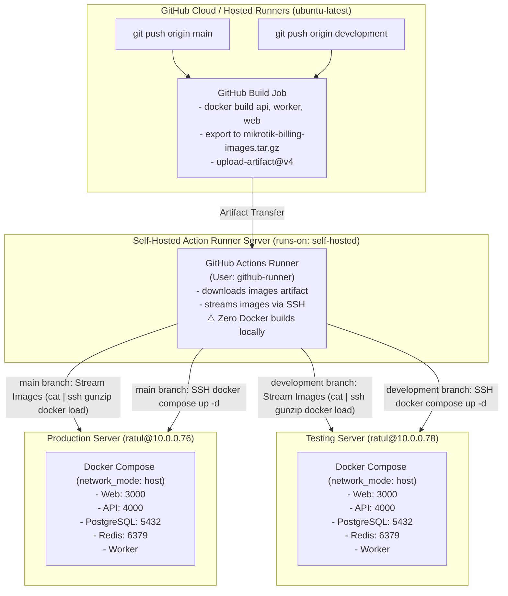

# GitHub Actions CI/CD Pipeline Architecture & Operations Guide

This document details the automated continuous integration and continuous deployment (CI/CD) architecture for the **MikroTik ISP Billing & RouterOS Operations Platform** running on **GitHub Actions**.

---

## 1. Pipeline Topology & Node Inventory

The workflow splits image building (GitHub Cloud) from production/testing deployment (Self-Hosted Runner over private LAN):



### Server & Job Matrix

| Role | Environment | Runner / Host | Responsibilities | Trigger |
|---|---|---|---|---|
| **Build Job** | GitHub Hosted | `ubuntu-latest` | Builds Docker images (`api`, `worker`, `web`) on GitHub's infrastructure and uploads compressed archive. | All pushes to `main` & `development` |
| **Self-Hosted Runner** | Local Subnet | `github-runner` (`self-hosted`) | Orchestrates deployment. Downloads artifact and streams images directly to target servers over SSH. **Builds zero images.** | After build completion |
| **Production Server** | Production | `ratul@10.0.0.76` | Receives loaded images, runs `docker compose up -d` in host network mode, and exposes services. | `main` branch |
| **Testing Server** | Staging / QA | `ratul@10.0.0.78` | Receives loaded images, runs `docker compose up -d` in host network mode, and exposes services. | `development` branch |

---

## 2. Security & SSH Key Configuration

The GitHub self-hosted runner executes jobs under the system user **`github-runner`**. It uses pre-configured SSH keys to access `ratul@10.0.0.76` and `ratul@10.0.0.78`.

### Verification from the Action Runner Server

To verify that the `github-runner` user has valid passwordless SSH access to both servers:

```bash
# Switch to the github-runner user
sudo su - github-runner

# Test SSH connection to Production Server (10.0.0.76)
ssh -o StrictHostKeyChecking=no ratul@10.0.0.76 "echo 'Connected to Production (10.0.0.76) as \$(whoami)'"

# Test SSH connection to Testing Server (10.0.0.78)
ssh -o StrictHostKeyChecking=no ratul@10.0.0.78 "echo 'Connected to Testing (10.0.0.78) as \$(whoami)'"
```

---

## 3. Pipeline Stages & Execution Flow

### Stage 1: Cloud Image Build (`build`)

- **Runs On**: `ubuntu-latest` (GitHub Hosted Cloud Runner)
- **Workflow**:
  1. Checks out repository code.
  2. Builds the three production images via Docker BuildKit:
     ```bash
     docker build --target api -t mikrotik-billing-api:latest .
     docker build --target worker -t mikrotik-billing-worker:latest .
     docker build --target web -t mikrotik-billing-web:latest .
     ```
  3. Saves and compresses all three images into a single transfer archive:
     ```bash
     docker save mikrotik-billing-api:latest mikrotik-billing-worker:latest mikrotik-billing-web:latest | gzip -1 > mikrotik-billing-images.tar.gz
     ```
  4. Uploads archive as a GitHub Actions workflow artifact with 1-day retention.

### Stage 2: In-Memory Streaming Deployment (`deploy-production` / `deploy-testing`)

- **Runs On**: `self-hosted` (Your Action Runner server, running as `github-runner`)
- **Workflow**:
  1. Checks out repository files and downloads the built images artifact.
  2. Synchronizes repository configuration (`docker-compose.yml`, scripts) to the target server, strictly excluding `.env` to preserve production secrets.
  3. **Direct Image Streaming**: Streams the Docker images directly to the target server's Docker daemon without saving intermediate files to the target disk:
     ```bash
     cat mikrotik-billing-images.tar.gz | ssh ratul@<target-host> "gunzip | docker load"
     ```
  4. Immediately removes the downloaded archive from the runner to preserve runner disk space.
  5. Ensures `.env` exists (initializes from `.env.example` if fresh install).
  6. Launches services via Docker Compose:
     ```bash
     docker compose up -d
     ```
  7. Prunes obsolete dangling images (`docker image prune -f`).
  8. Probes `http://127.0.0.1:4000/api/v1/health` up to 15 times to verify that the NestJS API is operational.

---

## 4. Branching Strategy & Triggers

| Git Action | Target Branch | Pipeline Jobs Executed | Target Deployment |
|---|---|---|---|
| `git push origin development` | `development` | `build` $\rightarrow$ `deploy-testing` | **Testing Server** (`http://10.0.0.78:3000`) |
| `git push origin main` | `main` | `build` $\rightarrow$ `deploy-production` | **Production Server** (`http://10.0.0.76:3000`) |
| Manual Run (`workflow_dispatch`) | Selected branch | Runs build and deploys to the environment matching the selected branch | Dependent on branch |

---

## 5. Troubleshooting & Diagnostics

### Diagnostic Commands

#### 1. Checking Container Status on Target Host:
```bash
# Production
ssh ratul@10.0.0.76 "cd /home/ratul/docker/mikrotik-billing-system && docker compose ps"

# Testing
ssh ratul@10.0.0.78 "cd /home/ratul/docker/mikrotik-billing-system && docker compose ps"
```

#### 2. Streaming Container Logs:
```bash
ssh ratul@10.0.0.76 "cd /home/ratul/docker/mikrotik-billing-system && docker compose logs -f api"
ssh ratul@10.0.0.76 "cd /home/ratul/docker/mikrotik-billing-system && docker compose logs -f worker"
ssh ratul@10.0.0.76 "cd /home/ratul/docker/mikrotik-billing-system && docker compose logs -f web"
```

#### 3. Manual API Health Probe:
```bash
curl -I http://10.0.0.76:4000/api/v1/health
# Expected: HTTP/1.1 200 OK
```
