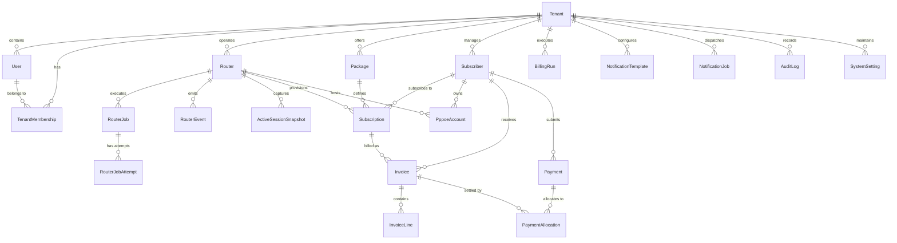

# Database Architecture & Entity-Relationship Documentation

## 1. Entity-Relationship Diagram (ERD)

---

## 2. Model Specifications & Tenancy Scoping

### 2.1 Identity & Access
- **`Tenant`**: Root organizational entity for each independent ISP.
- **`User`**: Identity record containing email, passwordHash (Argon2id), and profile metadata.
- **`TenantMembership`**: Explicit mapping between User and Tenant with tenant-specific `UserRole` (`PLATFORM_ADMIN`, `ISP_ADMIN`, `ISP_OPERATOR`, `CASHIER`, `AUDITOR`).
- **`Session`**: Refresh tokens and session metadata with client fingerprint and expiry.

### 2.2 MikroTik Network & Operations
- **`Router`**: Represents physical or Cloud Hosted Router (CHR) MikroTik devices.
  - Sensitive credentials encrypted with AES-256-GCM (`encryptedPassword`).
  - Tracks operational state: `connectionStatus`, `lastSeenAt`, `rosVersion`, `uptime`, `cpuLoad`.
- **`RouterJob`**: Asynchronous task tracking desired network mutation vs confirmed execution.
- **`RouterJobAttempt`**: Execution audit log with duration, error traceback, and response code.
- **`RouterEvent`**: Network alerts (interface drop, authentication failures, reboot).
- **`ActiveSessionSnapshot`**: Cached observation of active PPPoE sessions from router API.

### 2.3 Subscribers & Internet Services
- **`Subscriber`**: ISP customer with unique `accountNumber`, personal details, and service address.
- **`Package`**: Bandwidth plan with `downloadSpeedKbps`, `uploadSpeedKbps`, `priceMinor`, `billingCycle`, and MikroTik profile mapping.
- **`Subscription`**: Active link between a subscriber, package, and router. Lifecycle state: `PENDING`, `ACTIVE`, `GRACE_PERIOD`, `SUSPENDED`, `EXPIRED`, `TERMINATED`.
- **`PppoeAccount`**: PPPoE secret details. `username` is unique per tenant. `encryptedPassword` is securely stored for router provisioning.

### 2.4 Double-Entry Billing & Ledgers
- **`Invoice`**: Period invoice. Unique billing guard `[subscriptionId, billingPeriodStart]` prevents duplicate invoicing. Minor integer currency units prevent floating-point calculation drift.
- **`InvoiceLine`**: Itemized charges.
- **`Payment`**: Financial receipt. Tracks `method`, `amountMinor`, `status`, and `externalReference`.
- **`PaymentAllocation`**: M-to-N ledger allocation linking payments to invoices.
- **`BillingRun`**: Records scheduled automated billing cycles with dry-run support.

### 2.5 Notifications & Auditing
- **`NotificationTemplate`**: Customizable message templates (due reminder, payment received, suspension notice).
- **`NotificationJob`**: Outbound SMS queue with delivery tracking and retry count.
- **`AuditLog`**: Immutable audit log of all administrative actions, credential updates, and financial operations.
